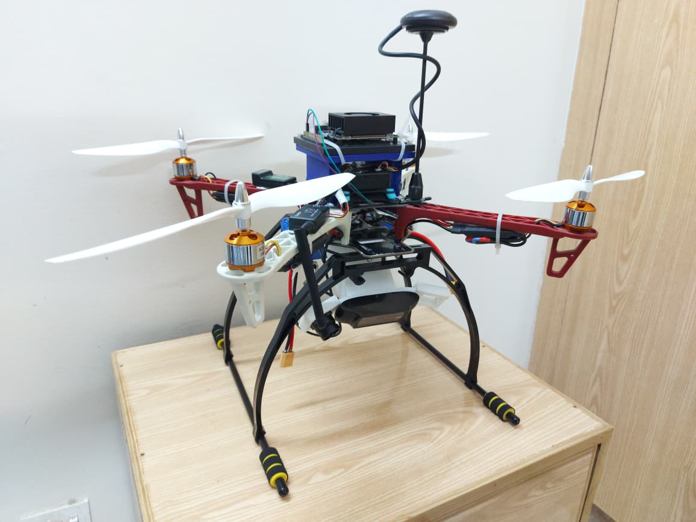
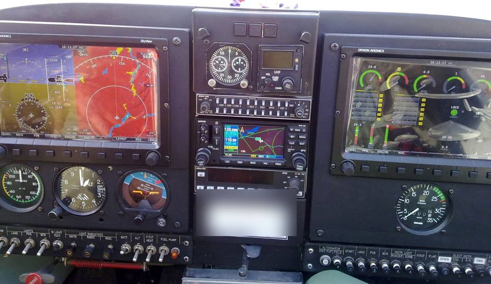
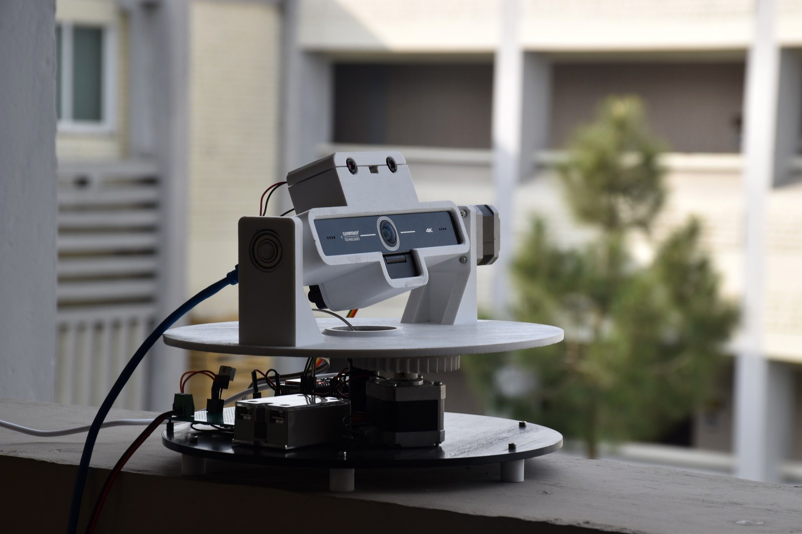

# Muhammad Umair Raza
### Aerospace Systems Integration · Autonomous Systems · Applied AI Engineering

**Engineering and applied-R&D leader** with 18+ years across aircraft development, avionics integration, testing/acceptance, fleet sustainment and multidisciplinary technical delivery. My current work combines **physical autonomy, embedded/edge AI, sensing, robotics interfaces and systems verification**. I lead engineering architecture, integration decisions and experiment/V&V strategy while working with teams delivering real hardware and software.

**[LinkedIn](https://www.linkedin.com/in/mumairaza/)** · **[Engineering career record](profile/AI_BASE_RESUME.md)** · **[Research & publications](research/README.md)** · **[Technical review requests](PRIVATE_REPOSITORY_ACCESS.md)**

> **Current flagship:** [Clear Run / TIR-FOD](domains/01-autonomy-edge-ai/CLEAR_RUN_ENGINEERING_CASE_2026_10.md) has progressed from airborne FOD perception to a **fabricated tracked/skid-steer retrieval prototype and a project-lead-confirmed integrated mission demonstration**. October day/night and pickup figures are team-reported, with repeatability and independently traceable success still to be established. [October maturity update](domains/01-autonomy-edge-ai/CLEAR_RUN_2026-10_STATUS.md).

## Three engineering cases to start with

| Applied autonomy / perception | Aircraft-level systems integration | Physical AI tracking |
|:--|:--|:--|
|  |  |  |
| **[Clear Run — UAV–GCS–UGV](domains/01-autonomy-edge-ai/CLEAR_RUN_ENGINEERING_CASE_2026_10.md)**: sensing, localization, GCS tasking and real collection hardware; prototype mission demonstrated, reliability work ongoing. | **[Super Mushshak retrofit](domains/04-assurance-digital-engineering/super-mushshak-digital-engineering.md)**: lead systems engineer across avionics/sensor interfaces, modification harness, installed ground/flight testing and OEM actions. | **[Counter-UAS Phase I](domains/01-autonomy-edge-ai/counter-uas.md)**: completed physical visual-tracking research prototype, camera/mount integration and indoor/outdoor trials; later multisensor fusion remains proposed. |

*The three images above are actual project photographs from already-public evidence, not renders of a proposed system. The UAV is from the earlier TIR-FOD airborne-sensing programme; it is not an image of the later tracked collection rover.*

### Technical evidence that hiring teams can inspect

- **TIR-FOD:** 3,499 LWIR source frames, 5,593 annotated objects, 23 categories and 29 recorded training runs; [dataset DOI](https://doi.org/10.5281/zenodo.22546586), [reproducibility evidence](evidence/autonomy_edge_ai/tir_fod/reproducibility/README.md). Model-evaluation claims distinguish ordinary frame splits from acquisition-block and leakage-controlled testing.
- **Clear Run:** RGB/LWIR edge perception, Jetson/TensorRT, mission interfaces, ground-control tasking and fabricated collection hardware; [current maturity](domains/01-autonomy-edge-ai/CLEAR_RUN_2026-10_STATUS.md) and [what the field evidence actually supports](evidence/autonomy_edge_ai/clear_run/README.md).
- **Aerospace delivery:** aircraft integration, requirements/interfaces, configuration, OEM coordination, installed tests and feedback into the engineering baseline; [retained historical verification case](https://github.com/razaumair2203-ux/Super-Mushshak-Glass-Cockpit-Modification).

## Specializations and selected work

| Engineering domain | Selected cases | What they demonstrate |
|---|---|---|
| **Physical autonomy & embedded AI** | [Clear Run](domains/01-autonomy-edge-ai/CLEAR_RUN_ENGINEERING_CASE_2026_10.md) · [Counter-UAS](domains/01-autonomy-edge-ai/counter-uas.md) · [multi-UAV SAR](research/MULTI_UAV_SAR_CASE.md) | Perception, cross-subsystem integration, robotics and simulation-based mission verification |
| **Aerospace, radar & RF engineering** | [Aircraft retrofit](domains/04-assurance-digital-engineering/super-mushshak-digital-engineering.md) · [IN-ARCP radar detection](research/INARCP_RADAR_CASE.md) · [GNSS/CRPA research](research/README.md) | Aircraft lifecycle, high-integrity sensing, statistical detection and interference mitigation research |
| **Regulated, evidence-driven AI products** | [i-MSHA](domains/02-compliance-regtech/i-msha.md) · [Lodestar](domains/02-compliance-regtech/lodestar.md) | Governed public-data analytics, legal/RAG evidence structures, reliability controls; independent development, not production claims |
| **Practical agentic software** | [JobLooper](domains/03-practical-ai-products/joblooper-jobpilot.md) · [Adversarial Review Lite](domains/03-practical-ai-products/adversarial-review-lite.md) · [BuildSignal AI](domains/03-practical-ai-products/buildsignal-ai.md) | Human-approved workflows, state/provenance, independent review, controlled tool execution |
| **AI assurance / digital engineering** | [Evidence-linked MBSE](domains/01-autonomy-edge-ai/ai-systems-assurance-mbse.md) · [CloakBench](research/CLOAKBENCH_CASE.md) · [ATLAS HPC](domains/04-assurance-digital-engineering/atlas-hpc.md) | Verification, reproducible evaluation, failure-mode analysis and research infrastructure |

*These are separate streams: institutional/team aerospace and autonomy work is not portrayed as independently owned software; experimental systems are not described as certified, adopted or commercial deployments.*

## Photo-authentic engineering media · October 2026

The following media cards were assembled **only from authentic, already-public project photographs, trial captures, browser screenshots or research result figures**, with source Git blob identities retained in each SVG's metadata. Typography and layout are editorial; no equipment or scene was generated.

| Media | Evidence represented |
|---|---|
| [Clear Run / applied autonomy — authentic UAV photo](visuals/editorial/clear-run-autonomy-2026.svg) | Earlier real aerial platform + current mission-chain summary; not a photo of the latest tracked rover |
| [Super Mushshak / aircraft integration — installed cockpit](visuals/editorial/super-mushshak-systems-2026.svg) | Original installed prototype photograph and verified engineering scope |
| [Counter-UAS / physical AI — mount and outdoor frame](visuals/editorial/counter-uas-physical-ai-2026.svg) | Real fabricated mount and experimental visual-tracking capture |
| [i-MSHA / regulatory intelligence — authentic browser screenshot](visuals/editorial/i-msha-product-engineering-2026.svg) | Genuine development dashboard; not a production-status claim |
| [IN-ARCP / radar research — real detection-result plot](visuals/editorial/inarcp-radar-evidence-2026.svg) | Actual computed R22 research curve; not operational radar certification |
| [Multi-UAV SAR / mission simulation — real test-result plot](visuals/editorial/multi-uav-sar-evidence-2026.svg) | Actual command-loss simulation result, not field flight data |

## Research status and release boundaries

- **TIR-FOD:** IEEE Access resubmission confirmed **6 October 2026**, decision pending; [public dataset](https://doi.org/10.5281/zenodo.22546586).
- **Clear Run integrated-system manuscript:** submitted / under consideration as author-reported in October 2026; no publication acceptance claimed.
- **IN-ARCP:** IEEE Transactions on Radar Systems submission reported **7 October 2026**; [public R22 code and reproducibility record](https://github.com/razaumair2203-ux/inarcp).
- **Multi-UAV SAR:** simulation study and journal packages prepared; submission outstanding. **CloakBench:** research snapshot unfinished. [Details and supporting work](research/README.md).

**Attribution:** My direct contribution includes engineering/programme direction, systems architecture and interfaces, experimental/evaluation design, integration and verification leadership. Flight, mechanical, ROS, avionics and student team implementation is credited to the respective multidisciplinary contributors. Historical aircraft programmes and independent software products are not conflated.

**Review route:** [Request a scoped, public-safe technical review package](PRIVATE_REPOSITORY_ACCESS.md) or [connect on LinkedIn](https://www.linkedin.com/in/mumairaza/). Detailed working repositories, unreleased trials, personal records and sensitive programme information are not automatically public.

Current portfolio landing: 25 October 2026 · [Archived previous landing](archive/README_2026-10-25_before_repositioning.md)
