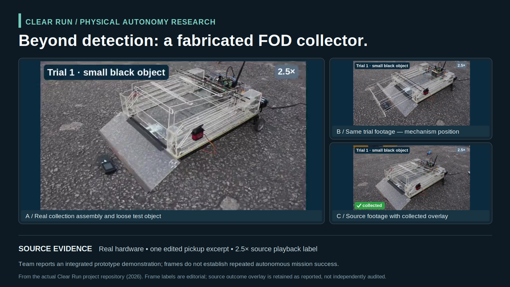
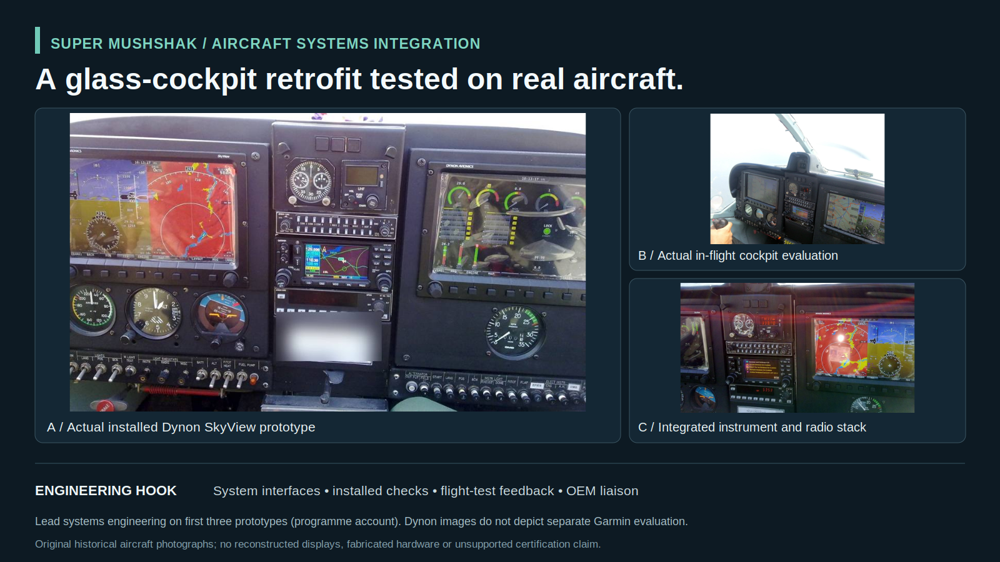
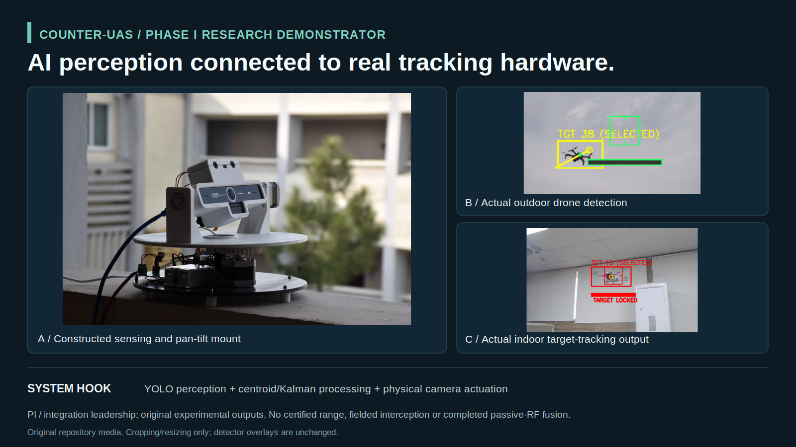

# Muhammad Umair Raza
### Aerospace Systems Integration · Autonomous Systems · Applied AI

**Engineering and R&D leader with 18+ years spanning avionics development, aircraft-level integration, flight/ground verification, configuration management and technical programme delivery.** My present research connects airborne perception, edge computing, ground robotics, experimental validation and system assurance. I lead systems architecture, interfaces, integration decisions and engineering verification across multidisciplinary teams.

[**LinkedIn**](https://www.linkedin.com/in/mumairaza/) · [**Aircraft and programme leadership**](profile/LEADERSHIP_PROFILE_2026_10.md) · [**Research and publications**](research/README.md) · [**Original media and provenance**](media/showcase/README.md)

---

## Selected systems engineering and applied-R&D evidence

### 01 · Clear Run | Detection-to-retrieval autonomy

**Engineering challenge:** connect airborne RGB/LWIR foreign-object detection to target events, supervised ground-control tasking and actual physical retrieval. The Clear Run programme has fabricated collection hardware and a **team-reported integrated prototype demonstration**; reproducible, configuration-linked detection-to-retention reliability remains open.

**My contribution:** programme and systems-integration leadership, interface/test strategy, embedded-AI evaluation, technical acceptance and multidisciplinary coordination. The media above comes from **Clear Run project footage**, not a substituted Phase-I sensing UAV. The frames are one 2.5× edited collection excerpt, not independent trial repetitions.

[**Current engineering case and maturity**](domains/01-autonomy-edge-ai/CLEAR_RUN_ENGINEERING_CASE_2026_10.md) · [**Original collector frames**](media/showcase/README.md#clear-run--fabricated-debris-collection-prototype) · [**Programme research record**](research/README.md)

### 02 · Super Mushshak | Flight-tested avionics retrofit

**Engineering challenge:** integrate new cockpit displays, sensor interfaces, NAV/COM, aircraft electrical/harness modifications and configuration-specific verification in a flying trainer aircraft. Ground checks, flight-test feedback and OEM discrepancy resolution informed successive prototype configurations.

**My contribution:** lead systems/avionics integration engineering on the **first three prototype aircraft** (programme account). Dynon and Garmin evaluation paths are separately identified; downstream contracts and aircraft deliveries are programme context, not personal sales attribution.

[**Aircraft engineering case**](domains/04-assurance-digital-engineering/super-mushshak-digital-engineering.md) · [**Original photographs and source record**](https://github.com/razaumair2203-ux/Super-Mushshak-Glass-Cockpit-Modification)

### 03 · TIR-FOD | 23-class thermal perception and edge deployment

**Research output:** **3,499 original LWIR frames**, **5,593 object annotations**, **23 FOD categories** and released source-aware splits. The programme includes repeated YOLO experiments and Jetson Orin Nano/TensorRT flight integration. The image uses **the original annotated thermal samples**—not generic FOD icons or generated scenes.

**My contribution:** experimental design, model/evaluation protocol, deployment and validation review, technical direction and manuscript development. This is the **airborne sensing/edge-AI evidence stream**; it must not be counted as proof of the later ground-retrieval mission.

[**Public dataset (Zenodo DOI)**](https://doi.org/10.5281/zenodo.22546586) · [**Full thermal class montage and original source**](media/showcase/README.md#tir-fod--all-23-genuine-lwir-fod-classes) · [**Research and deployment case**](domains/01-autonomy-edge-ai/clear-run-tir-fod.md)

### 04 · Counter-UAS Phase I | Physical AI tracking demonstrator

**Engineering output:** a constructed camera/actuator demonstrator combining YOLO detection, centroid/Kalman processing and pan-tilt tracking, with real indoor and outdoor experimental captures. This is a **vision-tracking prototype**, not an operational counter-drone system or completed passive-RF sensor fusion.

**My contribution:** principal-investigator and systems-integration leadership; prototype implementation and trials were team-developed.

[**Physical demonstrator case**](domains/01-autonomy-edge-ai/counter-uas.md) · [**Original mount, trial captures and training curves**](media/showcase/README.md#counter-uas-phase-i--physical-vision-tracking)

---

## Further reproducible research and engineering assurance

| Project | Evidence of engineering depth | Maturity |
|---|---|---|
| [IN-ARCP — adaptive radar detection](research/INARCP_RADAR_CASE.md) | [Recorded detector analysis](media/showcase/inarcp-r22-detector.png), compound-Gaussian clutter, target self-masking and false-alarm control | Numerical research; manuscript under review |
| [Multi-UAV search and rescue](research/MULTI_UAV_SAR_CASE.md) | [Recorded simulation comparison](media/showcase/multi-uav-command-loss.png) and separately reported ArduPilot SITL campaign | Simulation/SITL; manuscript not submitted |
| [Evidence-linked MBSE and Clear Run telemetry assurance](domains/01-autonomy-edge-ai/ai-systems-assurance-mbse.md) | Requirements/interfaces, producer–consumer fault replay and explicit verification boundaries | Bounded retrospective model and replay, not a certified safety case |
| [CloakBench](research/CLOAKBENCH_CASE.md) | Adversarial detector evaluation distinguishing suppression from displacement | Research in progress; no complete benchmark claim |
| [Adaptive GNSS CRPA interference suppression](research/README.md) | 8-element array work; IBCAST 2026 conference record | Research contribution, not a deployed certified GNSS product |

## Independent systems and applied-AI software

| Project | What I engineered or led | Public evidence boundary |
|---|---|---|
| [i-MSHA](domains/02-compliance-regtech/i-msha.md) | Governed safety analytics over U.S. MSHA data, API/data architecture and bounded AI assistance | [Authentic historical v1 screenshot](visuals/compliance-regtech/i-msha/dashboard-regression.png); private v2 remains pre-launch |
| [Lodestar](domains/02-compliance-regtech/lodestar.md) | Authority-grounded legal-evidence retrieval, citation constraints, structured assessment states and regression tests | Selected public-safe code/fixtures; private corpus metrics are dated |
| [JobLooper / JobPilot](domains/03-practical-ai-products/joblooper-jobpilot.md) | Evidence-bounded career-data workflow, controlled drafting and deterministic document release | [Inspectable public JobLooper source](https://github.com/razaumair2203-ux/Pub-JobLooper) |
| [Adversarial Review Lite](domains/03-practical-ai-products/adversarial-review-lite.md) | Cross-model review CLI tools with scope freezing, mutation checks and human release controls | [Codex](https://github.com/razaumair2203-ux/codex-adversarial-review-lite) · [Claude](https://github.com/razaumair2203-ux/claude-adversarial-review-lite) |
| [BuildSignal AI](domains/03-practical-ai-products/buildsignal-ai.md) | Local publishing/research operations, source/media governance and controlled review states | Private work in progress; no fabricated hosted UI |
| [ATLAS GPU/HPC](domains/04-assurance-digital-engineering/atlas-hpc.md) | Accountable institutional leadership for a reported 22-node research-computing environment | Leadership case; no sensitive internal topology |

## Engineering leadership beyond GitHub

My historical engineering foundation includes **JF-17 development/integration and fleet configuration management, ZDK-03 AEW&C sustainment, Super Mushshak prototype retrofit and aircraft test/acceptance support**. These experiences connect present autonomy research to the aircraft engineering lifecycle: requirements, interfaces, suppliers/OEMs, configuration, field evaluation, risk and accountable delivery.

[**Detailed career evidence and leadership scope**](profile/LEADERSHIP_PROFILE_2026_10.md) · [**Public research record**](research/README.md) · [**Technical discussion and contact**](PRIVATE_REPOSITORY_ACCESS.md)

*Evidence standard: physical photographs, recorded results, released data and public code are distinguished from team-reported demonstrations and future work. Sensitive programme implementation, private evaluation inputs and unreleased records are not made public.*

Public engineering portfolio · Updated 25 October 2026
