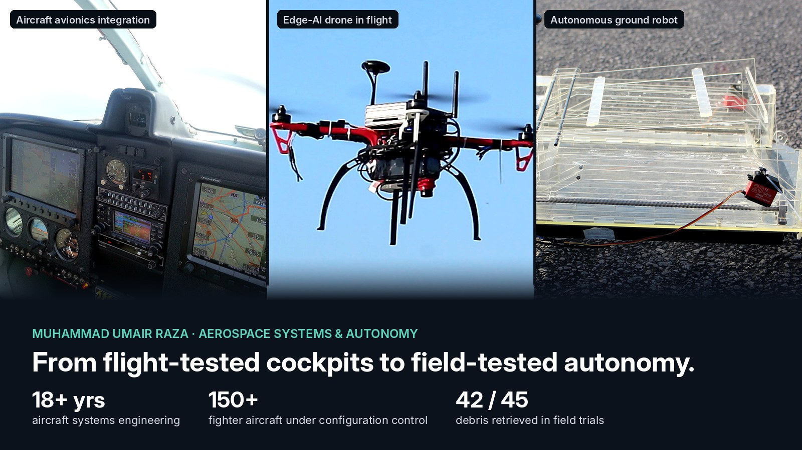
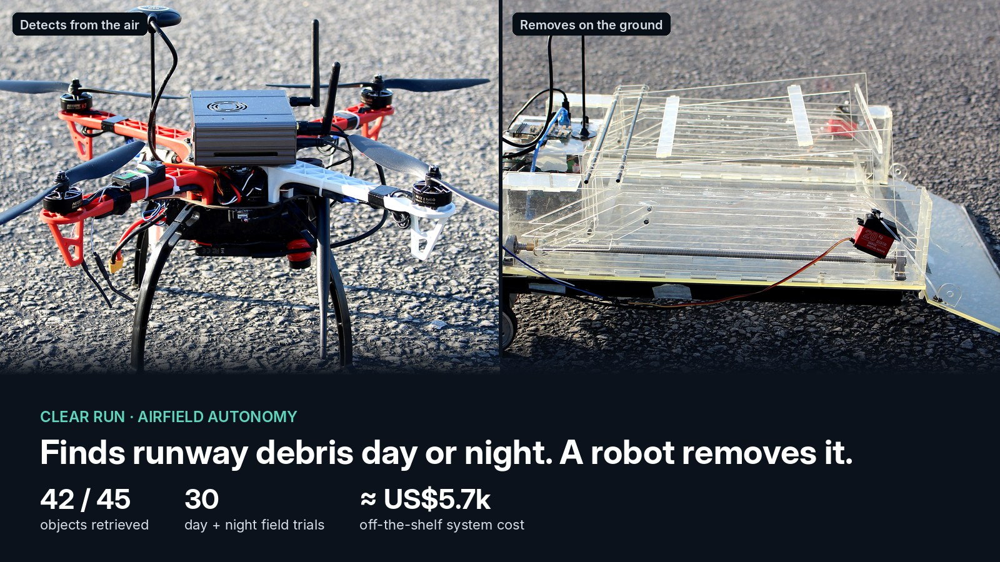
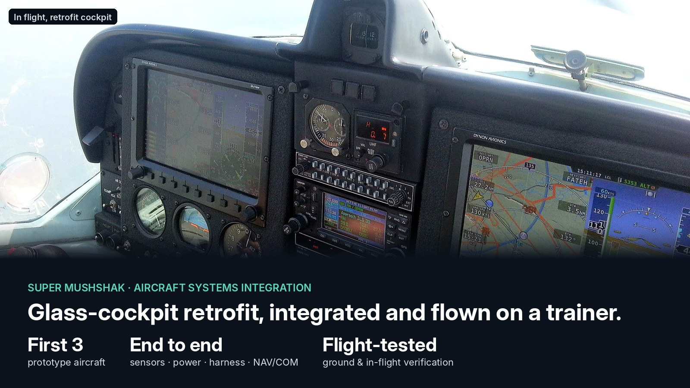
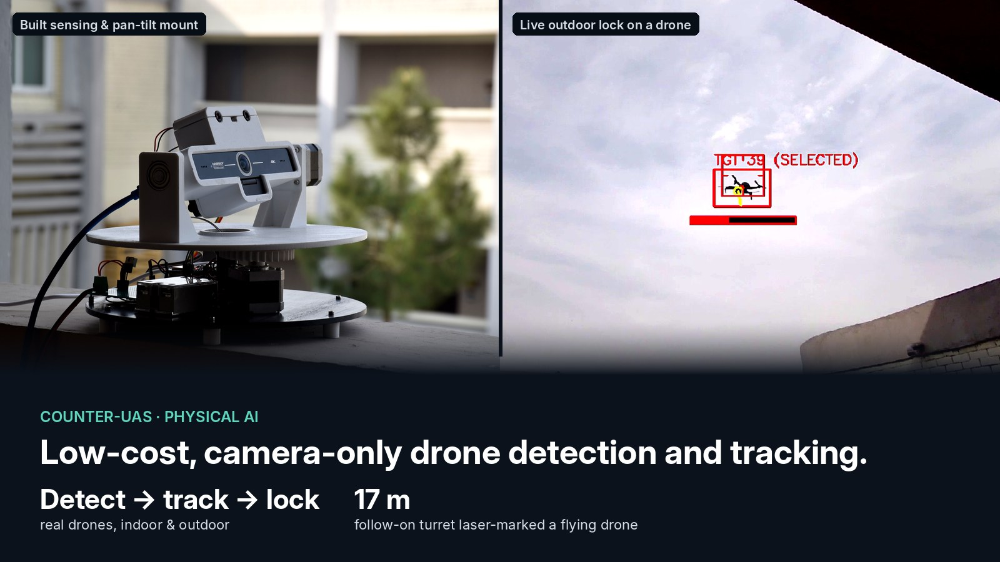

# Muhammad Umair Raza
### Aerospace Systems & Autonomy Engineering Leader

I take new technology from the lab bench to the airframe, and prove it works. **18 years in Pakistan Air Force aerospace programmes**: avionics development, aircraft integration, fleet configuration and sustainment. Today I lead AI and robotics R&D that keeps **airfields and airspace safe**.

| **18+ yrs** | **150+** | **135+** | **42 / 45** |
|:---|:---|:---|:---|
| aerospace systems engineering | JF-17 aircraft under the configuration system I built | JF-17 backup computers fielded from a subsystem I developed | runway debris objects retrieved by Clear Run in field trials |

[**LinkedIn**](https://www.linkedin.com/in/mumairaza/) · [**Career & credentials**](profile/README.md) · [**Publications**](research/README.md) · Pakistan-based · transferable Saudi Iqama, available for Saudi Arabia / GCC

---

## Flagship work

### Clear Run — find runway debris from the air, remove it on the ground

**Why it matters:** debris on runways damages engines and tyres, costing aviation an estimated US$4 billion a year in direct damage. Most research only *detects* it; Clear Run also removes it, by day and after dark.

**What I did:** I lead the programme as principal investigator. I defined the drone → ground station → rover architecture, set the field-test strategy and led the multidisciplinary engineering team through integration.

**Result:** **42 of 45 placed debris objects retrieved (93%)** across **30 day and night field trials**, with ≈ US$5,700 of off-the-shelf hardware. Journal article finalised for IEEE Access; systems-engineering case under review at INCOSE. **[Read the case →](domains/01-autonomy-edge-ai/CLEAR_RUN_ENGINEERING_CASE_2026_10.md)**

### Super Mushshak — glass-cockpit retrofit, integrated and flown

**Why it matters:** modernising a flying trainer means changing sensors, power, wiring, radios and pilot workload together, then proving every change on the ground and in the air.

**What I did:** I led avionics systems integration on the **first three prototype aircraft**: architecture, a complete modification harness, interfaces, ground and flight test, OEM fault closure and customer evaluation.

**Result:** prototypes flight-tested and handed to production. *Programme outcome:* the upgraded aircraft went on to win **export orders from four countries**. **[Read the case →](domains/04-assurance-digital-engineering/super-mushshak-digital-engineering.md)**

### TIR-FOD — seeing runway debris at night from a drone

**Why it matters:** colour cameras are nearly blind at night, and there was little public thermal data to train debris detectors on.

**What I did:** first author. I designed the dataset and experiments, exposed a data-leakage trap that inflates accuracy by 8.5 points, and directed deployment on a Jetson-equipped drone.

**Result:** an open dataset of **3,499 thermal frames and 23 debris classes** ([DOI](https://doi.org/10.5281/zenodo.22546586)); **27 of 30 targets detected on night flights**. Article under review at IEEE Access. **[Read the case →](domains/01-autonomy-edge-ai/clear-run-tir-fod.md)**

### Counter-UAS — low-cost, camera-only drone tracking

**Why it matters:** cheap drones threaten airports and bases, and radio-based detectors miss drones that use no radio link.

**What I did:** principal investigator for Phase I. I defined the camera → AI detector → tracker → pan-tilt loop and led a student engineering team through indoor and outdoor trials.

**Result:** a working **detect → track → lock** demonstrator on real drones. In a follow-on target-designation demo, the turret **laser-marked a flying drone at 17 m** using a single camera. **[Read the case →](domains/01-autonomy-edge-ai/counter-uas.md)**

---

## More research

| Project | What it shows | Status |
|---|---|---|
| [Multi-drone search and rescue](research/MULTI_UAV_SAR_CASE.md) | Which planner gains survive lost commands; validated with **640 ArduPilot SITL flights** | Manuscript ready |
| [IN-ARCP radar detection](research/INARCP_RADAR_CASE.md) | Keeps radar false alarms on target (0.73–1.47×) where standard rules overshoot up to 60× | Open-source package · manuscript prepared |
| [Evidence-linked MBSE for Clear Run](domains/01-autonomy-edge-ai/ai-systems-assurance-mbse.md) | Capella model and telemetry replay tying requirements to test evidence | Under review, INCOSE |
| [GNSS anti-jamming (8-element CRPA)](research/README.md) | Adaptive antenna-array interference suppression | Presented, IBCAST 2026 |
| [Adversarial patches vs. detectors](research/CLOAKBENCH_CASE.md) | Measures whether "invisible" patches hide people or just move the box | In progress |

Peer-reviewed: two IEEE ICoDT2 2025 papers on real-time multi-stream detection and adversarial patches. [All publications →](research/README.md)

## I still build software

| Product | What it does |
|---|---|
| [i-MSHA](domains/02-compliance-regtech/i-msha.md) | Mine-safety analytics over U.S. MSHA open data (FastAPI · DuckDB · Next.js) |
| [Adversarial Review Lite](https://github.com/razaumair2203-ux/codex-adversarial-review-lite) | Open-source tools where one AI model independently reviews another's code ([Claude version](https://github.com/razaumair2203-ux/claude-adversarial-review-lite)) |
| [JobLooper](https://github.com/razaumair2203-ux/Pub-JobLooper) | Open-source, local-first job-application workflow with human approval at every step |
| [Lodestar](domains/02-compliance-regtech/lodestar.md) | Retrieval-grounded assistant that maps evidence to legal criteria with citations |

## Career at a glance

**NUST College of Aeronautical Engineering** — R&D and systems engineering lead, 100+ project portfolio, 22-node GPU cluster (2023–now) · **JF-17 programme office** — Deputy Director Avionics (2019–22) · **Chengdu Aircraft Design Institute, China** — customer-side systems engineering lead (2017–19) · **ZDK-03 AEW&C** — mission-systems MRO (2015–17) · **Pakistan Aeronautical Complex** — avionics development and integration (2008–13). Pakistan Air Force career since 2008.

PMP · PMI-ACP · Professional Engineer · MS Avionics · [Full career →](profile/README.md)

**Open to** senior systems-integration, autonomy, test & verification and R&D leadership roles. [Message me on LinkedIn](https://www.linkedin.com/in/mumairaza/).
