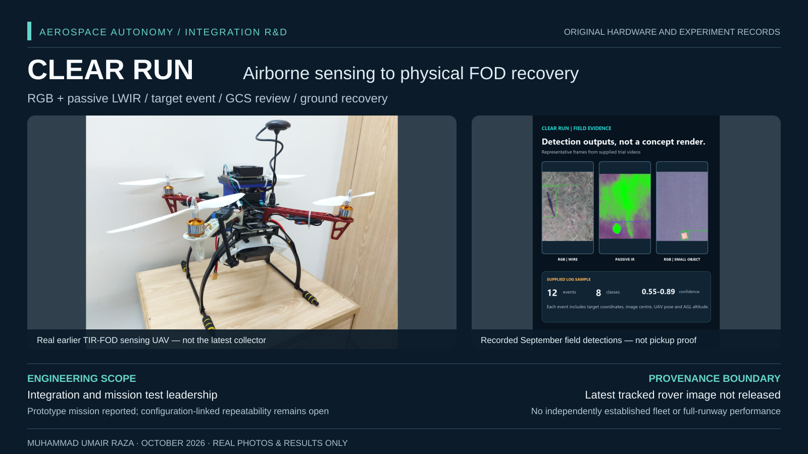
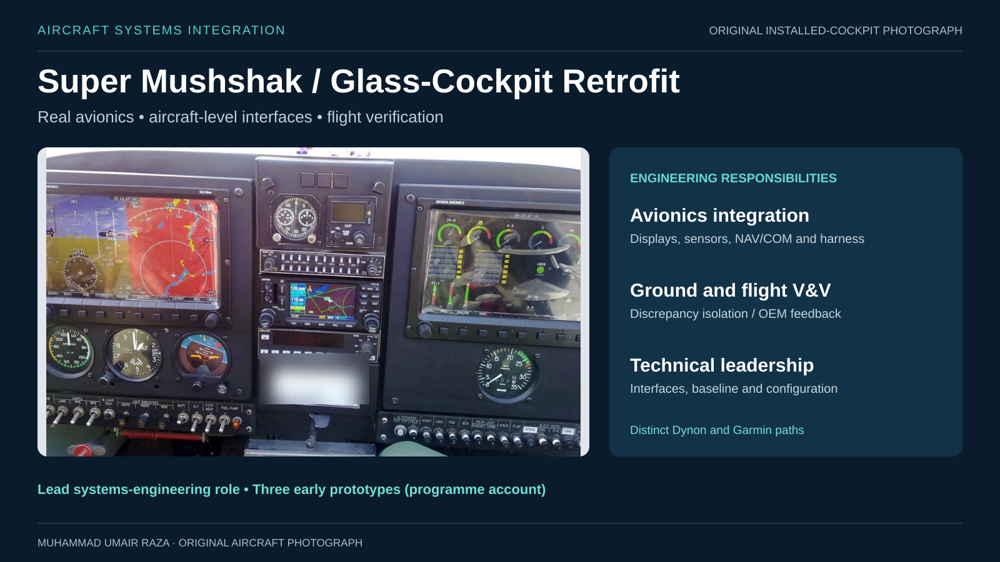
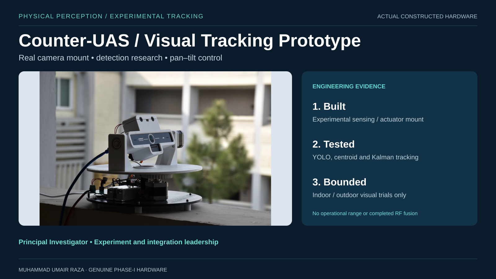

# Muhammad Umair Raza
### Aerospace Systems Integration · Autonomous Systems · Applied AI

**Engineering and R&D leader with 18+ years in aircraft programmes, avionics integration, verification, technical programme delivery and fleet sustainment.** I now lead multidisciplinary work connecting edge perception, mission systems, robotics and engineering assurance. My engineering foundation includes JF-17 development and fleet programmes, ZDK-03 AEW&C sustainment and the Super Mushshak glass-cockpit retrofit.

[**LinkedIn**](https://www.linkedin.com/in/mumairaza/) · [Engineering leadership and programme scale](profile/LEADERSHIP_PROFILE_2026_10.md) · [Publications and research](research/README.md) · [Original photographs and experiment media](media/showcase/README.md)

## Selected engineering case studies

### 01 / Clear Run — airborne sensing to physical FOD recovery

**The engineering problem:** carry foreign-object-debris detections from airborne RGB/LWIR sensors through localization, ground-control review and an actual ground collection prototype. A team-built integration demonstration is reported; configuration-linked end-to-end reliability remains to be independently verified. The photograph shows the earlier **TIR-FOD sensing UAV**, not the subsequent collection rover.

[Engineering integration and current maturity](domains/01-autonomy-edge-ai/CLEAR_RUN_ENGINEERING_CASE_2026_10.md) · [Actual detection outputs](visuals/autonomy-edge-ai/clear-run/field_trial_evidence.png) · [Original hardware and field media](media/showcase/README.md#clear-run)

### 02 / Super Mushshak — flight-tested avionics integration

**Lead systems-engineering work:** retrofit design and integration across cockpit displays, sensors, NAV/COM, wiring, configuration control, installed ground checks, flight-test feedback and OEM discrepancy resolution. Three initial prototypes are reported in the programme record; Dynon and Garmin evaluation paths are distinguished.

[Aircraft engineering case](domains/04-assurance-digital-engineering/super-mushshak-digital-engineering.md) · [Original flight and cockpit photographs](media/showcase/README.md#super-mushshak)

### 03 / Counter-UAS Phase I — built vision-tracking demonstrator

**Principal Investigator / integration lead:** physical camera/mount development, YOLO-based perception, centroid/Kalman-based tracking controls and indoor/outdoor experiments. This is an experimental visual-tracking system, not evidence of operational counter-UAS performance or completed passive-RF fusion.

[Physical prototype case](domains/01-autonomy-edge-ai/counter-uas.md) · [Genuine outdoor trial output](visuals/autonomy-edge-ai/counter-uas/outdoor_detection.png) · [Original media](media/showcase/README.md#counter-uas-phase-i)

## Sensing, autonomy and reproducible research

| Engineering case | Concrete evidence | Maturity |
|---|---|---|
| [TIR-FOD / thermal edge AI](domains/01-autonomy-edge-ai/clear-run-tir-fod.md) | [Real mounted Jetson and capture-session media](media/showcase/04-tir-fod.svg); [public dataset](https://doi.org/10.5281/zenodo.22546586), 3,499 LWIR source frames, 5,593 annotations across 23 classes | Field R&D, article under consideration |
| [IN-ARCP radar detection](research/INARCP_RADAR_CASE.md) | [Original R22 detector plot and source-backed media](media/showcase/05-inarcp.svg), compound-Gaussian clutter and target self-masking | Manuscript submitted, decision pending |
| [Multi-UAV search and rescue](research/MULTI_UAV_SAR_CASE.md) | [Original simulated command-loss media](media/showcase/06-multi-uav-sar.svg), separate 640 reported SITL flights | Simulation-only, manuscript not submitted |
| [Clear Run MBSE and telemetry assurance](domains/01-autonomy-edge-ai/ai-systems-assurance-mbse.md) | Explicit requirements, interface fault replay and acceptance checks | Bounded software replay, not a certified safety case |
| [CloakBench](research/CLOAKBENCH_CASE.md) | Displacement-versus-suppression detector evaluation | Research in progress; private unfinished repository |

## Independent engineering software

| Project | Engineering differentiator | Evidence |
|---|---|---|
| [i-MSHA](domains/02-compliance-regtech/i-msha.md) | MSHA data modelling, governed analytics and AI-assisted workflows; [authentic archived v1 UI](media/showcase/07-i-msha.svg) | Historical screenshot; newer private v2 remains pre-launch |
| [Lodestar](domains/02-compliance-regtech/lodestar.md) | Authority-grounded legal evidence retrieval and explicit uncertainty controls | Public-safe code/fixtures and dated private evaluation |
| [JobLooper / JobPilot](domains/03-practical-ai-products/joblooper-jobpilot.md) | Source-bound CV/advert processing, human review, deterministic document release | [Public JobLooper source](https://github.com/razaumair2203-ux/Pub-JobLooper) |
| [Adversarial Review Lite](domains/03-practical-ai-products/adversarial-review-lite.md) | Reciprocal cross-model review utilities with read-only/release controls | [Open-source CLI implementations](https://github.com/razaumair2203-ux/codex-adversarial-review-lite) |
| [BuildSignal AI](domains/03-practical-ai-products/buildsignal-ai.md) | Next.js editorial platform with local content, media, audio and research workflows; validation scripts | Private local development; no production-adoption claim |
| [ATLAS HPC](domains/04-assurance-digital-engineering/atlas-hpc.md) | Accountable leadership for a reported 22-node GPU/HPC research environment | Institutional leadership record, not public topology |

## How I lead engineering

I define system boundaries and interfaces, coordinate multidisciplinary hardware/software teams, set verification priorities and manage test evidence and configuration decisions. My contributions are **technical direction, integration, engineering acceptance and experiment/V&V leadership**; team-developed flight software, mechanical systems, student projects and aircraft programmes are credited accordingly.

My career extends beyond these repositories: **JF-17 integration and fleet configuration, ZDK-03 AEW&C flight-line engineering, aircraft acceptance/qualification support, OEM coordination and engineering leadership across lifecycle phases** are documented in the [programme leadership profile](profile/LEADERSHIP_PROFILE_2026_10.md).

**Public evidence is selective by design.** Sensitive aircraft details, private trials, unreleased source, credentials and personal test data are not published. Claims distinguish recorded tests, author-reported programme progress, proposed capabilities and production-grade validation. A scoped technical review can be requested through [the contact route](PRIVATE_REPOSITORY_ACCESS.md).

Public engineering portfolio · October 2026
