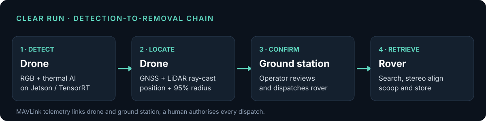

# Clear Run — find runway debris from the air, remove it on the ground

**A low-cost drone, ground station and robot that detect, locate and retrieve foreign-object debris (FOD) on airfields, by day and after dark.**

## Why it matters

A loose bolt or stone on a runway can be ingested by an engine or burst a tyre. Industry estimates put direct FOD damage at around **US$4 billion a year** ([SKYbrary](https://skybrary.aero/articles/foreign-object-debris-fod)). Most research stops at *detecting* debris; somebody still has to walk out and pick it up. Clear Run closes that loop, and keeps working at night, when debris is hardest to see.

## What I did

I lead Clear Run as principal investigator, with a multidisciplinary team of engineers and students.

- **Defined the system architecture:** drone → ground control station → rover, and every interface between them.
- **Set the evaluation strategy:** day/night field trials, success criteria and a 1,000-run simulation study.
- **Directed the perception work:** RGB and thermal detectors, including the open thermal dataset [TIR-FOD](clear-run-tir-fod.md).
- **Led integration and acceptance** of the drone payload, ground station and collection robot.
- **Wrote the journal article** as first and corresponding author.

## Results

| Measure | Result |
|---|---|
| Field trials on paved operational surfaces | **30** (15 by day, 15 after dark) |
| Placed debris objects retrieved | **42 of 45 (93%)** |
| Rover distance from object when terminal guidance began | **1.27 m** mean |
| Time to completed pickup | **81 s** mean |
| Local search vs. no search (1,000 simulations, 4 cm objects) | **94% vs. 17%** found within 30 s |
| Hardware cost | **≈ US$5,700**, off-the-shelf parts |

## How it works

1. **Detect.** The drone runs colour and thermal (LWIR) detectors on an NVIDIA Jetson with TensorRT.
2. **Locate.** It ray-casts each detection to the ground using GNSS, attitude and tilt-corrected LiDAR height, and sends a position with a 95% uncertainty radius over MAVLink.
3. **Confirm.** An operator reviews each report at the ground control station and dispatches the rover.
4. **Retrieve.** The rover drives to the area, searches within the uncertainty circle, aligns with stereo vision and scoops the object.

The human stays in the loop for every dispatch decision, which is how an airfield authority would expect such a system to start.

## Status

Journal article finalised for submission to IEEE Access (October 2026). The systems-engineering case study is under review at INCOSE. Phase III (multi-drone, multi-rover runway coverage) is in planning.

**Related:** [TIR-FOD thermal dataset](clear-run-tir-fod.md) · [MBSE and verification case](ai-systems-assurance-mbse.md) · [Dataset DOI](https://doi.org/10.5281/zenodo.22546586)

[← Back to portfolio](../../README.md)
