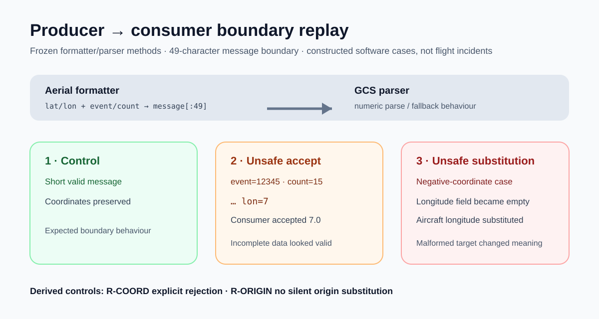

# Clear Run MBSE: catching interface defects before they reach the runway

A Capella/Arcadia model and a software replay that check the Clear Run detect-to-retrieve chain end to end.

## Why it matters

A target on the ground-station screen is only useful if its coordinates are right. A wrong value sends the rover to the wrong place, and the operator may never notice.

## What I did

- **Built** a Capella 7.1 / Arcadia model of the Clear Run mission chain (Sep 2026).
- **Linked** each system claim to its interface, requirement and test evidence.
- **Replayed** the real telemetry formatter and parser in isolation to test the UAV-to-ground link.
- **Derived** two new interface requirements from the defect the replay exposed.
- **Wrote** the practitioner case for INCOSE.

## Results

- Model: **3 mission components, 14 logical functions, 13 functional exchanges**; validation with **0 errors**.
- Replay found that the formatter cuts messages at **49 characters**.
- With extra metadata, a longitude was cut to `lon=7` and accepted downstream as **7.0**.
- With a negative coordinate, the empty field was silently replaced by the **aircraft's own longitude**.
- Both cases now map to explicit acceptance tests.

## How it works

The replay feeds constructed messages through the inspected formatter and parser code. Before any result counts as evidence, four checks apply:

1. **Location** — was it observed where the claim is owned?
2. **Configuration** — do model, calibration, hardware and software match?
3. **Trace** — is it linked to a function, exchange and requirement?
4. **Acceptance** — is there a pass/fail rule and a recorded result?

New requirements:

- **R-COORD** — the ground station recovers valid target coordinates at the declared precision and rejects incomplete messages.
- **R-ORIGIN** — target coordinates never fall back to aircraft position when target data are missing.

## Status

Submitted to INCOSE Applications & Case Studies (IACS), 16 Sep 2026.

## Links

- [Replay cases (JSON)](../../evidence/autonomy_edge_ai/mbse/telemetry_replay_cases.json)
- [Mission verification matrix (JSON)](../../evidence/autonomy_edge_ai/clear_run/mission_verification_matrix.json)
- [Clear Run engineering case](CLEAR_RUN_ENGINEERING_CASE_2026_10.md)

[Back to portfolio](../../README.md)
