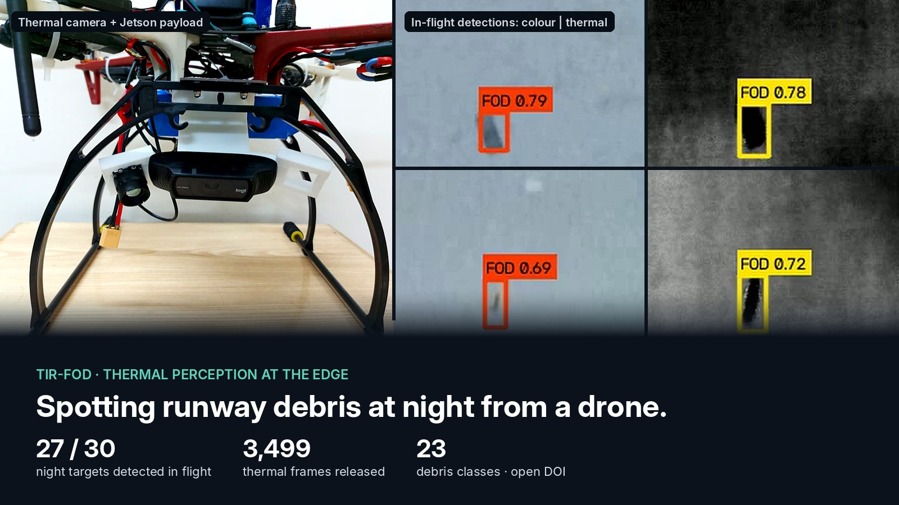
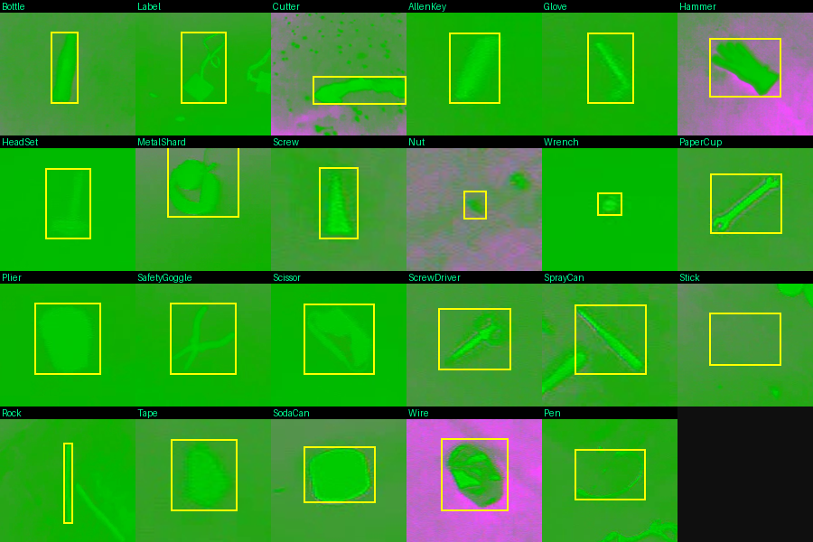

# TIR-FOD — seeing runway debris at night from a drone

**An open thermal-infrared dataset and edge-AI detector for foreign-object debris on airfields, flown on a Jetson-equipped drone.**

## Why it matters

Runway inspections happen around the clock, but colour cameras are nearly blind at night. Thermal (LWIR) cameras can see debris in the dark, yet there was little public thermal data to train detectors on. TIR-FOD fills that gap and shows the detector working on a small drone, not just on a workstation.

## What I did

I am first and corresponding author, leading a team of engineers and students.

- **Designed the dataset:** capture campaign, 23-class taxonomy, annotation rules and a blind second annotation pass on 338 frames.
- **Designed the experiments:** 29 training runs across YOLOv8, YOLO11 and YOLO12, with repeated seeds.
- **Found a hidden evaluation trap:** frames from the same capture session leaking between training and test sets inflate accuracy. We measured it and released leak-free splits.
- **Directed edge deployment:** FP16 TensorRT on an NVIDIA Jetson Orin Nano, flown on a UAV over runway-like surfaces.

## Results

| Measure | Result |
|---|---|
| Released dataset | **3,499** thermal frames · **5,593** labelled objects · **23** debris classes |
| Best detector (YOLOv8n, 3.0 M parameters) | **0.86** mAP@[.50:.95] (±0.002 over seeds) |
| Accuracy inflation from session leakage | **+8.5 points**, now removed from the benchmark |
| Leak-free vs. naive split (12-class study) | **0.74 vs. 0.82** mAP, the honest generalisation gap |
| Night flights, independent conditions | **27 of 30** targets detected (90%) |
| Onboard throughput (Jetson Orin Nano) | **≈ 25 FPS** inference · **≈ 15.6 FPS** end to end |

## What it fed into

TIR-FOD is the night-vision layer of [**Clear Run**](CLEAR_RUN_ENGINEERING_CASE_2026_10.md), which goes further: it locates the debris and sends a robot to remove it.

## Status

Dataset public on Zenodo (v1.2, CC BY-NC 4.0). Journal article under review at IEEE Access (resubmitted October 2026).

**Links:** [Dataset DOI 10.5281/zenodo.22546586](https://doi.org/10.5281/zenodo.22546586) · [Reproducible training and scoring code](../../evidence/autonomy_edge_ai/tir_fod/reproducibility/README.md)

[← Back to portfolio](../../README.md)
