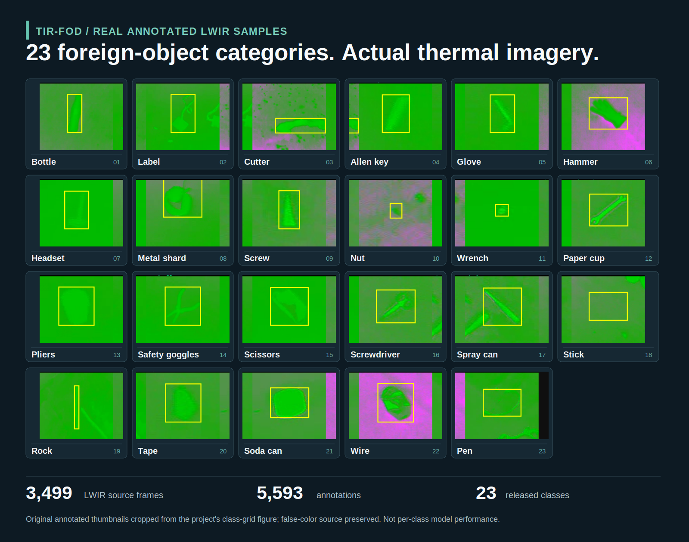
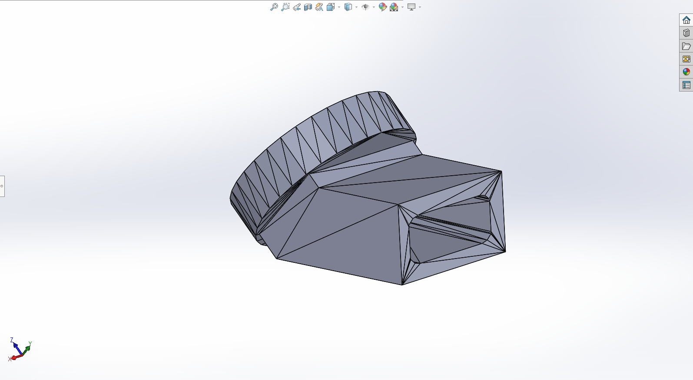
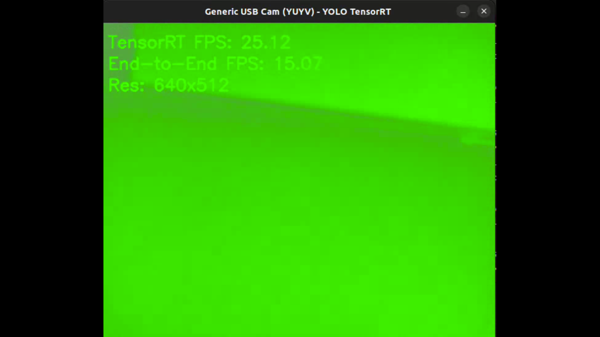

# TIR-FOD / Clear Run — edge AI and airfield robotics from detection to physical recovery

**Private technical review available:** [Request review →](https://github.com/razaumair2203-ux/applied-ai-portfolio/issues/new?template=access-clear-run.yml)

**Public evidence snapshot:** 19 September 2026. Historical measurements retain their original provenance and limitations where stated.

**Flagship dataset visual — original thermal annotations, all 23 classes:**

[Original unaltered class-grid source](../../media/real/tir-fod-23-class-source-grid.png) · [Released dataset](https://doi.org/10.5281/zenodo.22546586). The atlas enlarges source crops and labels; it is not a composite of synthetic FOD objects or per-class detection results.

**Scope distinction:** this page retains historical Phase-I dataset/Jetson records. The [current Clear Run collector engineering case](CLEAR_RUN_ENGINEERING_CASE_2026_10.md) and its [actual collection footage](../../media/showcase/clear-run-real-collector-sequence.png) describe later, different integration evidence.

Clear Run is an **airfield robotics programme**, not a standalone object detector. It connects **dataset/model development → airborne edge deployment → target geolocation and operator review → UAV–GCS–UGV mission integration → physical FOD capture and retained removal**. The programme is valuable precisely because it forces perception, avionics, communications, human supervision, ground autonomy and mechanical recovery to work as one traceable mission chain.

## At a glance

| Dimension | Current state |
|---|---|
| Problem | Detect, geolocate and ultimately retrieve runway Foreign Object Debris |
| Dataset | **3,499 LWIR source frames · 5,593 annotated objects · 23 classes** |
| Experiment programme | **29 completed training runs** across YOLOv8 / YOLO11 / YOLO12 configurations plus current multi-model LWIR work |
| Edge deployment | Jetson Orin Nano · FP16 TensorRT · UAV flight trials |
| Historical throughput | **25.0 FPS TensorRT-stage · 15.6 FPS end-to-end** ten-run summaries; raw per-run logs and historical engine not retained |
| Integrated runtime | concurrent RGB + passive-IR inference · YOLO/SAHI · geolocation · MAVLink/REST · GCS integration |
| Current verification focus | GCS→UGV hand-off, terminal alignment, physical capture and retained removal |
| My role | technical direction, architecture/interfaces, experiment and evaluation strategy, deployment review, integration gates and team leadership |

**Public dataset:** [TIR-FOD v1.2 — DOI 10.5281/zenodo.22546586](https://doi.org/10.5281/zenodo.22546586) · **Reproducibility:** [29-run result bundle](../../evidence/autonomy_edge_ai/tir_fod/reproducibility/README.md) · **Deployment code:** [sanitized Clear Run detector extract](../../evidence/autonomy_edge_ai/clear_run/README.md)

## AI contribution and engineering choices

The learned component is RGB/LWIR object detection. TensorRT FP16 provides the edge inference path; SAHI supports small-object processing at a cost in compute. Geolocation, message exchange, mission state and ROS2/Nav2/SLAM integration are separate software and robotics responsibilities. Detector confidence alone cannot establish coordinate accuracy or successful recovery.

The earlier September development snapshot used a ROS1/ROS2 hybrid Mecanum navigation path, including legacy motor bridging. That configuration must **not** be presented as the later reported tracked/skid-steer as-tested collector. See the [current integration case](CLEAR_RUN_ENGINEERING_CASE_2026_10.md) for the latest team-reported hardware baseline and verification limits.

**Role relevance:** technical leadership across perception, embedded deployment and system verification, with team-delivered hardware/software and explicit mission acceptance criteria.

## 1. TIR-FOD — dataset and controlled model evaluation

The released study contains **3,499 single-shot LWIR source frames**, **5,593 bounding-box annotations** across **23 FOD classes**, a larger offline-augmented archival pool, frozen source-lineage-aware partitions and a blind second annotation pass on **338 frames**.

The experiment programme includes **29 completed training runs** across YOLOv8n, YOLOv8s, YOLOv8m, YOLO11s, YOLO11m and YOLO12s.

Key results:

- best observed three-seed YOLOv8n mean mAP@[.50:.95]: **0.8603 ± 0.0017**;
- a size-matched contamination experiment increased mAP@[.50:.95] by **8.52 ± 0.19 percentage points**;
- on the shared 12-class experiment, acquisition-block-disjoint evaluation produced **0.7410 ± 0.0423**, compared with **0.8223 ± 0.0070** under frame-level partitioning.

The important engineering result is that **data lineage and capture-session structure materially changed the apparent model conclusion**.

*Acquisition-session structure is treated as an evaluation variable rather than hidden inside a random frame split.*

### Model lifecycle

The workflow includes configuration-driven resumable experiment queues, deterministic multi-seed training, recorded protocol deviations, validation-selected checkpoints, held-out test evaluation, per-class metrics, run histories, initializer checksums, experiment manifests, model conversion and deployment profiling.

## 2. Jetson / TensorRT flight deployment

  
  

  

*Original programme photographs show the UAV and installed Jetson compute. The camera-mount image is a CAD design view; it does not establish fabrication or installation by itself.*

The thermal detector was deployed on **Jetson Orin Nano** with a thermal payload and GNSS/Pixhawk flight stack and exercised through repeated runway UAV trials.

  

Historical records include onboard TensorRT inference, successful detections, misses and false detections, an author-confirmed ten-run mean of **25.0 FPS TensorRT-stage**, and **15.6 FPS end-to-end** with reported range **15.07–16.0 FPS**. The retained runtime display above records **25.12 FPS TensorRT / 15.07 FPS end-to-end**.

The raw ten-run logs and historical TensorRT engine were not retained, so those figures remain historical system measurements rather than checkpoint-reproducible benchmarks. A newer [named-checkpoint protocol](../../evidence/autonomy_edge_ai/tir_fod/deployment/named_checkpoint_protocol.json) requires hashes, per-frame timing and retained telemetry.

## 3. Clear Run — mission-system integration

Clear Run extends the perception work into an aerial-ground system with RGB and passive-IR streams, independent FP16 TensorRT models, YOLO/SAHI processing, synchronized recording, geolocation, MAVLink/REST interfaces, a purpose-built GCS, and a **Jetson Nano ground-autonomy stack combining ROS2 Nav2, RPLidar SLAM Toolbox, wheel/IMU odometry, Mecanum navigation and terminal visual-alignment/retrieval integration**.

*Recorded field-video evidence is retained in the programme archive. The public case study surfaces representative frames and the machine-readable event snapshot; these records demonstrate field inference output but are **not** used as precision/recall, geolocation-accuracy or mission-success metrics.*

Current field records demonstrate annotated RGB and passive-IR detections with class, confidence and target-coordinate outputs. The reviewed snapshot contains **8 unique trial videos** (5 RGB, 3 IR; approximately 12 min 45 s total) and **12 structured RGB event records across 8 reported classes**. Those records carry image location, target coordinates, UAV pose and altitude. Recorded model confidence spans **0.5488–0.8887** (mean **0.7125**) and logged altitude spans **1.176–2.334 m AGL** (mean **2.069 m**). These are pipeline/event statistics, not detector or geolocation accuracy.

The aggregate, non-location-sensitive snapshot is published as [`field_trial_snapshot.json`](../../evidence/autonomy_edge_ai/clear_run/field_trial_snapshot.json) and validated in CI.

In the September development snapshot, the GCS consolidated telemetry, detection review and dispatch while a hybrid ROS1/ROS2 Mecanum platform was under integration. This describes a historical development configuration, not the later reported tracked collector. The later team-reported collector has been fabricated and a complete prototype mission demonstration has been reported; quantitatively repeatable mission closure is not independently established. No public SLAM trajectory-error, repeatability or autonomous mission-success measurement is available.

### Subsystem evidence

The [current Clear Run engineering case](CLEAR_RUN_ENGINEERING_CASE_2026_10.md) identifies subsystem responsibilities and maturity. This gallery no longer substitutes designed subsystem posters for original hardware and recorded execution images.

### Mission verification status

| Mission stage | Evidence status | Quantitative closure required |
|---|---|---|
| RGB / passive-IR detection output | Demonstrated | trial denominators / ground truth for detection-performance metrics |
| Structured target-event logging | Demonstrated | persistence / tracking behavior under declared test conditions |
| Target geolocation | Coordinates produced | surveyed-target error distribution |
| GCS ingest / target handling | Implemented evidence | traced response/identity measurements across the deployed path |
| GCS → UGV assignment | Open measurement | acknowledgement success, latency, retries/failures |
| UGV approach / terminal alignment | Open measurement | arrival/alignment error, time-to-target, interventions |
| Physical capture | Development | success rate by object/geometry/approach condition |
| Retention after movement | Open measurement | retained-capture success under declared motion profile |
| Full detection → retention mission | Open measurement | end-to-end success with one traceable object identity |

The machine-readable [`mission_verification_matrix.json`](../../evidence/autonomy_edge_ai/clear_run/mission_verification_matrix.json) makes those gates explicit and is checked in CI so an intermediate subsystem cannot silently become a completed-mission claim. The final detection-to-physical-retention chain is still being quantitatively closed.

## Engineering impact

- **Leakage risk was quantified:** a controlled contamination experiment showed an invalid **+8.52 ± 0.19 percentage-point** uplift.
- **Generalisation was tested against acquisition shift:** block-disjoint evaluation produced a materially harder result than frame-level partitioning.
- **Deployment exposed system overhead:** inference-stage and end-to-end throughput are treated as different metrics.
- **The programme spans the mission chain:** sensing, inference, geolocation and GCS integration are active while hand-off, terminal alignment, collection and retention remain explicit integration gates.
- **Reusable engineering assets were created:** public data, split records, repeated-run metrics, training protocols, deployment measurement protocols and sanitized runtime code.

## Contribution boundary

- **Direct responsibility:** applied-R&D / systems-engineering leadership; technical direction; architecture and interface definition; experiment design; model/evaluation strategy; deployment review; KPI definition; integration and V&V gates; multidisciplinary team leadership; publication development.
- **Team-developed work:** UAV/airframe integration, GCS/UGV/ROS implementation, field execution and mechanical recovery are multidisciplinary outputs and are not represented as sole authorship.
- **Robotics contribution boundary:** ROS2/Nav2/SLAM are documented implementation and ongoing integration work under technical leadership; the portfolio does not claim original SLAM/Nav2 algorithm authorship or sole coding of the UGV stack.
- **Transition path:** the programme is progressing toward national-scale field trials, followed by a planned patent filing after field-trial maturation. National deployment/adoption and patent filing/pending/grant are not yet claimed.
- **Evidence rule:** model, field and mission claims are accepted only at the boundary actually measured; open end-to-end retrieval gates remain open until verified.

## Research status

- TIR-FOD dataset v1.2 is publicly released on Zenodo.
- The TIR-FOD manuscript was resubmitted to IEEE Access on 6 October 2026 and awaits a decision.
- Clear Run remains under active field integration and measurement.

[Back to portfolio](../../README.md) · [Technical implementation](../../evidence/README.md) · [Research record](../../research/README.md)
