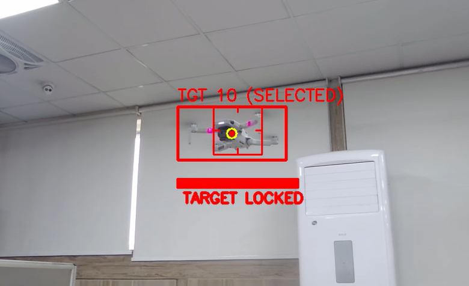
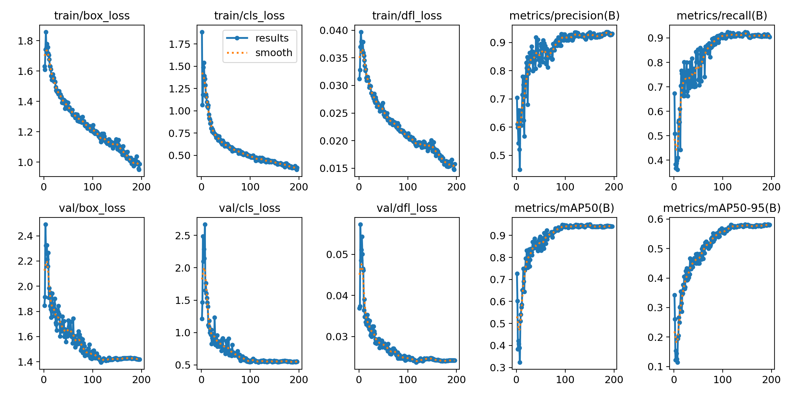

# Counter-UAS — low-cost, camera-only drone detection and tracking

**A built pan-tilt sensing mount that detects small drones with AI vision, locks on, and follows them in real time.**


## Why it matters

Small, cheap drones now threaten airports, bases and critical sites. Radar and RF detectors are expensive, and RF sensing fails against drones that use no radio link (for example fibre-optic control). A camera-only tracker built from off-the-shelf parts is an affordable layer that still works in those cases.

## What I did

I was principal investigator for Phase I, directing a student engineering team.

- **Defined the system:** camera, detector, tracker and pan-tilt actuation as one closed loop.
- **Set the AI approach:** a YOLO drone detector trained on ≈ 14,000 images and tested on a held-out 1,500-image set (640 px, 200 epochs).
- **Specified the tracking modes:** manual operator control, automatic single- and multi-target tracking, and Kalman-filtered smoothing.
- **Ran indoor and outdoor trials** against real quadcopters, and set the direction for the follow-on work.

## Results

- A working **detect → track → lock** loop on physical hardware, indoors and outdoors.
- Operator selects a target; the mount holds it centred automatically.
- **Follow-on turret (paper in preparation, I am lead author):** laser-marked a flying quadcopter at **17 m** in a target-designation demo (low-power pointer), using one camera and no radar, RF sensor or rangefinder.

<p>
  
  
</p>

## How it works

```text
camera frame → YOLO drone detector → target selection → Kalman tracker → pan-tilt steppers → camera re-centres
```



## Status

Phase I demonstrator complete. Next steps: longer-range optics, multi-sensor fusion (visual, acoustic, RF) and pointing-accuracy correction.

[← Back to portfolio](../../README.md)
