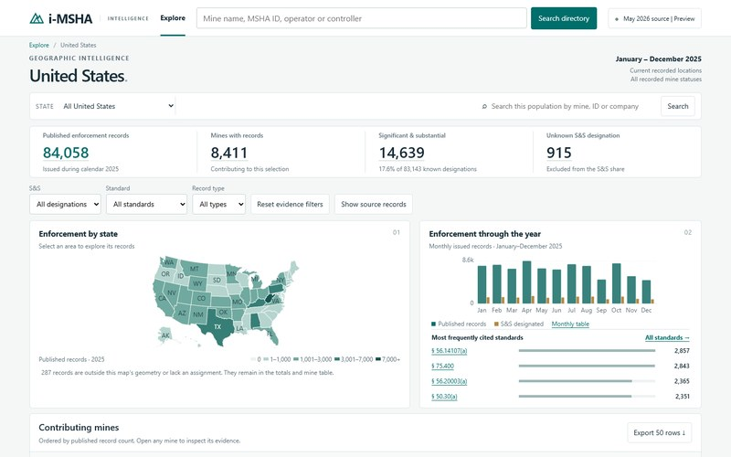

# i-MSHA: US mine-safety intelligence

One place to see every mine's violations, inspections, penalties and injuries, built from all public MSHA data.

## Why it matters

MSHA publishes rich safety data, but it is split across 20 weekly files. Consultants, operators, insurers and deal advisers rebuild the same joins by hand, and silent data gaps hide real risk.

## What I did

- **Defined** the product and its users as owner and product lead.
- **Designed** the data architecture: all 20 weekly MSHA files into DuckDB, served by FastAPI.
- **Ran** a raw-data reconciliation against the source files before trusting any dashboard.
- **Set** release gates: source verifiers, unit tests and Playwright browser checks must pass.
- **Built** with AI coding agents, working to my architecture and acceptance tests.

## Results

- Reconciliation over **1,145,416 rows** found **1,368 findings across 166 mines** being dropped. Fixed.
- **281/281** source verifiers pass.
- **102** tests on the first product module.
- v2 rebuilds an earlier v1 prototype (8 modules, 839 backend tests) on a leaner stack.

## How it works

Weekly MSHA files are downloaded, type-checked and loaded into DuckDB. FastAPI serves mine, controller and national views. Source verifiers check each dataset against the public MSHA files.

## Status

Pre-launch: staging targeted 9 Nov 2026, paid launch 21 Dec 2026.

## Links

Private repository; walkthrough available on request.

[Back to portfolio](../../README.md)
