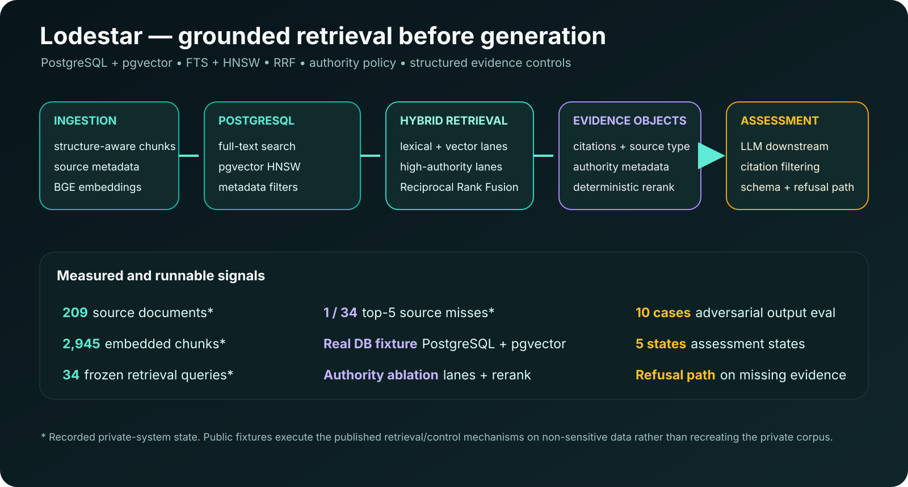

# Lodestar: evidence assessment with cited sources

An evidence-assessment assistant for complex immigration petitions. It maps documents to legal criteria and cites the authority behind every finding.

## Why it matters

Legal assessments fail when a model sounds confident without a source. Lodestar shows gaps plainly and refuses when evidence or authority is missing.

## What I did

- **Designed** the retrieval system: PostgreSQL full-text plus pgvector search, fused with Reciprocal Rank Fusion.
- **Added** authority-aware ranking so controlling sources outrank ordinary matches.
- **Defined** a five-state assessment with no scores or probabilities.
- **Built** output checks that drop invented citations and unknown evidence IDs.
- **Published** the retrieval and guardrail code with runnable tests.

## Results

- **209 documents, 2,945 chunks** indexed.
- **33 of 34** frozen queries return the expected source in the top 5.
- An answer citing a non-existent source is forced to **"unsupported" with a refusal**.
- **11** reliability invariants and **10** adversarial output cases pass.

## How it works

Next.js front end, FastAPI and PostgreSQL back end, local BGE embeddings. The model writes only after retrieval, and its output is checked against the retrieved sources.

## Status

Working v1 (private); retrieval and guardrail code public in this repo.

## Links

- [Code and how to run](../../evidence/compliance_regtech/lodestar/README.md)
- [Retrieval evaluation](../../evidence/compliance_regtech/lodestar/grounding-eval.md)

[Back to portfolio](../../README.md)
