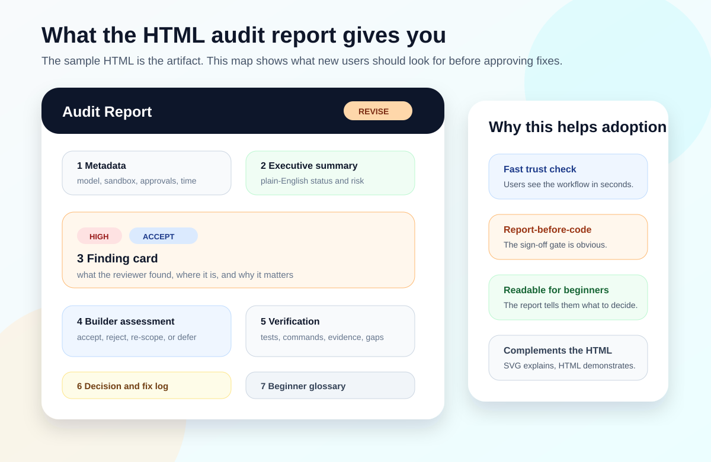
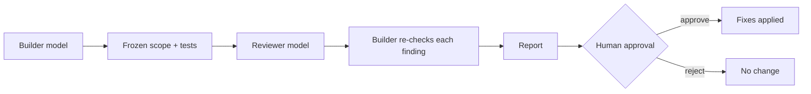

# Adversarial Review Lite: a second AI model checks the first

Free tools that make one coding agent review another's work, with the human approving every fix.

## Why it matters

Coding agents produce plausible code with hallucinated APIs, weak tests and scope drift. A second model catches different mistakes, but only if its findings are checked rather than obeyed.

## What I did

- **Designed** the builder–reviewer protocol: Claude builds and Codex reviews, or the reverse.
- **Defined** a frozen review scope with tests, fixtures and optional rubrics passed to the reviewer.
- **Added** file-hash checks so nothing changes until the human approves.
- **Built** cross-platform install and self-test for Windows, macOS, Linux and WSL.
- **Released** both tools under the MIT licence.

## Results

- **58** behavioural regression tests per package.
- In a live control run, the reviewer **found a seeded defect** and **approved a correct change**.
- Protocol 2 released 10 Oct 2026; reviewer model and effort selection added 11 Oct 2026.

## How it works

## Status

Released and public (MIT).

## Links

- [Claude Adversarial Review Lite](https://github.com/razaumair2203-ux/claude-adversarial-review-lite)
- [Codex Adversarial Review Lite](https://github.com/razaumair2203-ux/codex-adversarial-review-lite)

[Back to portfolio](../../README.md)
