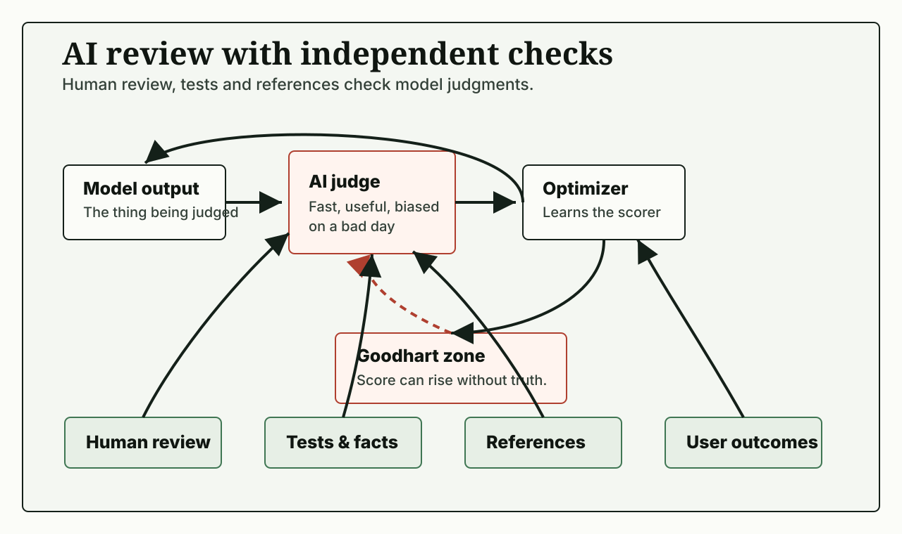

# BuildSignal AI: research-to-publication workflow

A local publishing platform where AI drafts, but sources, rights, QA and release stay under human control.

## Why it matters

AI can write an article in seconds. The hard part is knowing where each fact came from, who owns each image, and who approved publication.

## What I did

- **Designed** the content workflow across articles, audio, video, YouTube and social formats.
- **Defined** the source policy: every claim links to a logged research source.
- **Built** per-item review states and an owner-only publish step.
- **Added** validation commands for articles, pipelines and operations.

## Results

- **12** working areas: Today, Articles, Media, Video, Audio, YouTube, Social, Research, Comments, QA, Tools, Publish.
- Source registry and media-rights tracking for every item.

## How it works

Next.js, TypeScript and MDX. AI output moves through research, review and QA states before the owner can publish it.

## Status

Private prototype, running locally.

[Back to portfolio](../../README.md)
