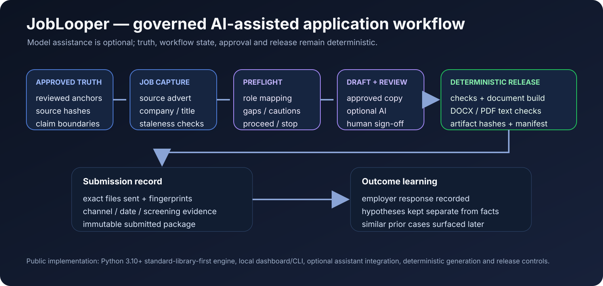

# JobLooper: job applications built from approved facts

A local-first app that tailors CVs and letters to the exact job advert, using only career facts the candidate has signed off.

## Why it matters

AI CV tools invent experience and lose track of which file went to which employer. One fabricated claim can end an application.

## What I did

- **Designed** the workflow as a state machine: approved facts → job advert → gap check → draft → review → build → submit → outcome.
- **Defined** the rule that AI can propose wording but cannot change approved facts or release documents.
- **Built** deterministic DOCX/PDF output, with each submission tied to the exact files sent.
- **Ran** a frozen evaluation (20 train / 15 validation / 15 held-out) before accepting prompt changes.

## Results

- Fabrication detection **1.00**; date-error detection **1.00**; metric-preservation detection **0.92**.
- A candidate prompt change was **blocked** because its gain was not statistically significant.
- Runs without an AI provider; model help is optional.

## How it works

Python 3.10+, mostly standard library. Content hashes flag stale inputs. Employer responses are logged as outcomes, separate from guesses about why.

## Status

Public repo; local-first Python app.

## Links

- [Pub-JobLooper on GitHub](https://github.com/razaumair2203-ux/Pub-JobLooper)
- [Evaluation method](../04-assurance-digital-engineering/ai-evaluation-workflows.md)

[Back to portfolio](../../README.md)
