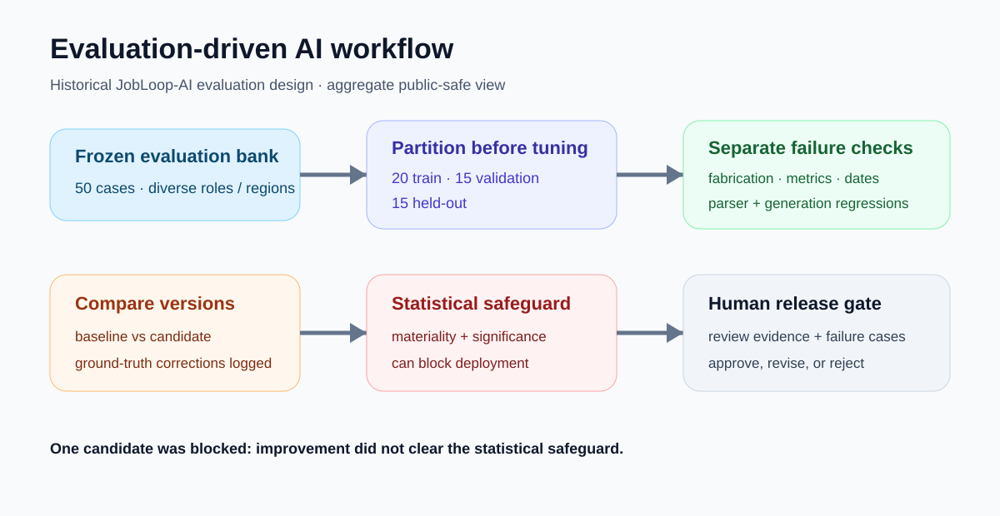

# AI evaluation workflows: measure before you ship

A test harness that decides whether an AI prompt change ships, using frozen held-out cases instead of a few good-looking outputs.



## Why it matters

A new prompt often looks better on the examples you happen to check. Without held-out tests, regressions in facts, dates and numbers reach users unnoticed.

## What I did

- **Designed** a 50-case bank, split **20 train / 15 validation / 15 held-out** before any tuning.
- **Defined** separate checks for fabrication, date errors and lost metrics.
- **Ran** parser rescoring after correcting ground truth, with each correction logged.
- **Set** a significance and materiality gate, followed by human review, before release.

## Results

| Check | Score |
|---|---:|
| Fabrication detection | **1.00** |
| Date-error detection | **1.00** |
| Metric-preservation detection | **0.92** |
| Baseline structural pass rate | **0.60** (reference 1.00) |
| Job-advert parser, 38 cases | mean **0.860**, median **0.883** |

- Test bank covers **9 persona types, 40 industries, 8 regions, 5 advert styles**.
- The gate **blocked** a prompt change whose gain was not statistically significant.

## How it works

```text
candidate change → frozen cases → held-out comparison
  → failure checks → significance gate → human review → release or reject
```

## Status

Method in use for JobLooper (May 2026 evaluation).

## Links

- [Aggregate results (JSON)](../../evidence/assurance_digital_engineering/ai_evaluation/evaluation_summary.json)
- [JobLooper](../03-practical-ai-products/joblooper-jobpilot.md)

[Back to portfolio](../../README.md)
