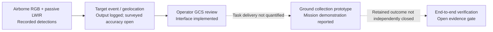
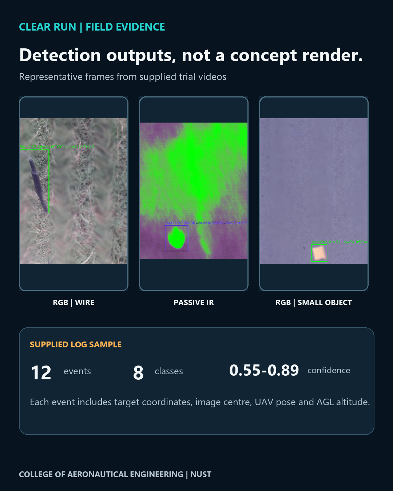
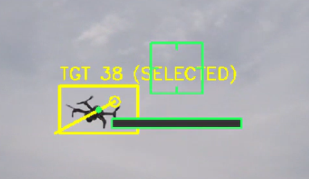
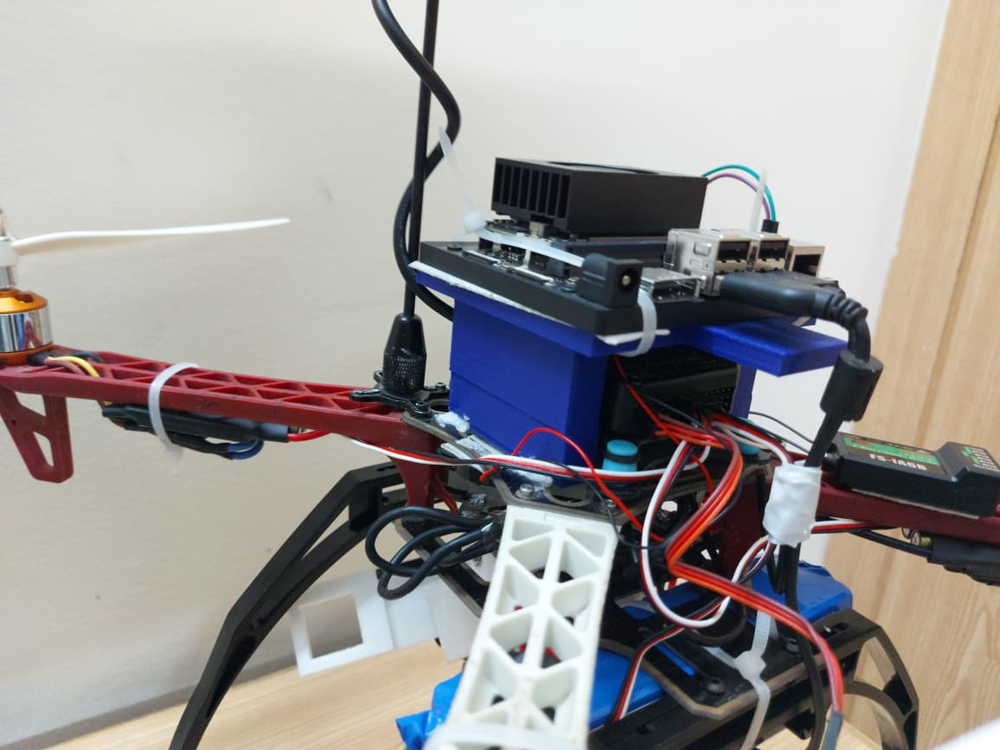
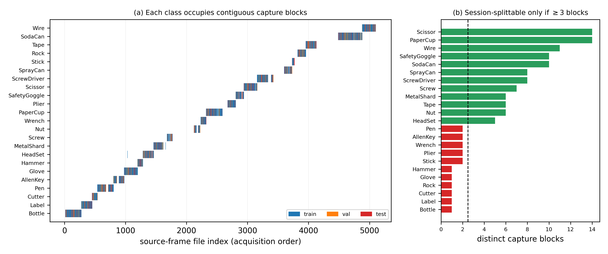
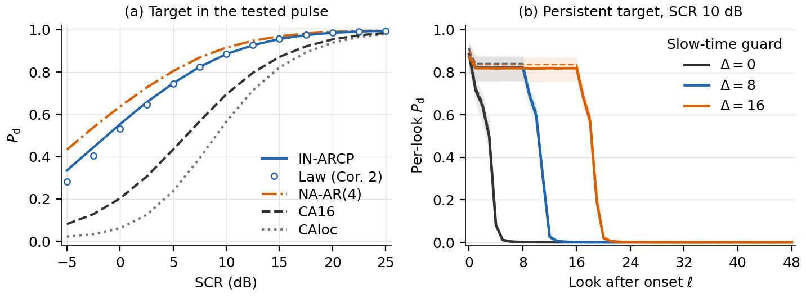
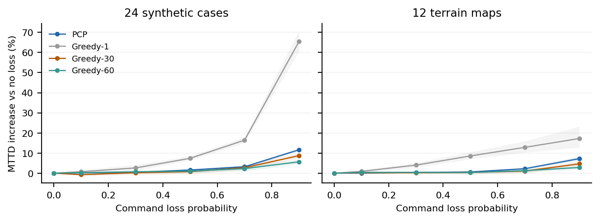
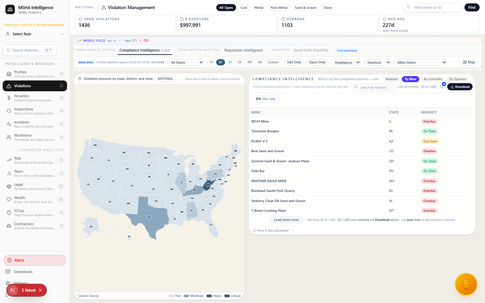

# Engineering media — original photographs and recorded results

The images below are **actual project photographs, recorded experimental outputs or screenshots** from the repositories named in their captions. They are not AI-generated hardware illustrations. The technical schematics and claims are discussed in the linked engineering cases; one photograph never establishes end-to-end reliability.

## Clear Run

The interface view below is a **functional evidence map**, not an as-built equipment illustration. Each arrow is an interface to verify.

| Earlier TIR-FOD aerial sensing platform | September field-detection outputs |
|---|---|
|  |  |
| Actual UAV photo; **not** the later collector | Original annotated RGB/LWIR results and 12 recorded RGB events; **not** evidence of successful physical pickup |

**Engineering result:** onboard perception, coordinates/events and GCS/ground interfaces; team reports a fabricated collector and integrated demonstration. The newer reported tracked ground platform is not pictured in this public gallery. [Current Clear Run case](../../domains/01-autonomy-edge-ai/CLEAR_RUN_ENGINEERING_CASE_2026_10.md) · [Released thermal dataset](https://doi.org/10.5281/zenodo.22546586).

## Counter-UAS Phase I

| Built experimental camera mount | Actual outdoor detection |
|---|---|
|  |  |
| Real constructed sensing/mount assembly | Original outdoor computer-vision output |

**Engineering result:** Phase-I experimental visual detection and pan/tilt tracking using detector, centroid/Kalman processing and physical trials. No qualified operational detection range, real-world interception claim or completed RF-fusion assertion. [Counter-UAS case](../../domains/01-autonomy-edge-ai/counter-uas.md).

## Super Mushshak

| Actual installed Dynon cockpit | Actual in-flight cockpit |
|---|---|
|  |  |
| Aircraft installation and integration | Period in-flight evaluation photo |

**Engineering result:** avionics, sensors, electrical and NAV/COM interfaces; flight feedback and configuration-sensitive verification. Dynon and Garmin evaluation paths are not a single installed configuration. [Aircraft engineering case](../../domains/04-assurance-digital-engineering/super-mushshak-digital-engineering.md) · [original photographic archive](https://github.com/razaumair2203-ux/Super-Mushshak-Glass-Cockpit-Modification/blob/main/docs/media-gallery.md).

## TIR-FOD — thermal sensing and edge deployment

| Actual mounted compute | Recorded capture-session analysis |
|---|---|
|  |  |
| Physical research-platform integration | Recorded research dataset evidence |

**Engineering result:** public 23-category LWIR dataset, Jetson/edge integration, repeated model evaluations with explicit split/protocol boundaries. [Reproducibility records](../../evidence/autonomy_edge_ai/tir_fod/reproducibility/README.md).

## IN-ARCP — reproducible radar research

**Original computed radar detection plot** from the public R22 study, including detection probability versus SCR and post-onset behavior. This is not a fielded radar benchmark. [Research case](../../research/INARCP_RADAR_CASE.md) · [public source](https://github.com/razaumair2203-ux/inarcp).

## Multi-UAV SAR — simulated command reliability

**Original recorded comparison** across 24 synthetic cases and 12 terrain maps. This is distinct from the separately reported 640 ArduPilot SITL flights; none are live search missions. [Research case](../../research/MULTI_UAV_SAR_CASE.md).

## i-MSHA — private regulatory analytics product

**Archived v1 development screenshot, not a production deployment or current test result.** The newer private i-MSHA v2 is a distinct pre-launch implementation; the historical image is not its current interface. [Product engineering case](../../domains/02-compliance-regtech/i-msha.md).

## Additional source-backed projects

Lodestar, JobLooper/JobPilot, Adversarial Review Lite, BuildSignal AI, CloakBench and ATLAS have case studies linked from the [main portfolio](../../README.md). Where a sanitized current product screenshot, physical photograph or retained benchmark is not publicly available, this gallery does **not** substitute a fictional interface, fabricated hardware photo or made-up result. The next admissible media is a real, authorized execution screenshot or test output.
