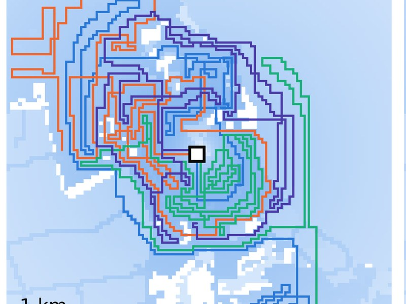

# Multi-UAV search and rescue: where planner gains really come from

A simulation study showing which parts of multi-drone search planning actually find people faster.

## Why it matters

Search teams need planners that still work when radio links drop. Published gains often mix three effects, so agencies cannot tell which one to rely on.

## What I did

- **Led** the study as first and corresponding author, with co-authors from NDMA and NUST SEECS.
- **Supervised** the final-year project (Saleha Abid) that built the simulations.
- **Designed** experiments that separate coordination, command duration and search-record accuracy.
- **Ran** replications over 800 synthetic scenarios and 50 real geographic sites.

## Results

- Goal deconfliction alone explains **92%** (synthetic) and **49%** (terrain) of a pattern planner's advantage.
- At **70% command loss**, detection time worsens **+2.54%** with 30-step commands, against **+19.36%** with single-step commands.
- Command duration, not pattern geometry, gives the tolerance to link loss.
- **640 ArduPilot SITL flights**: replayed commands reconstruct detection probability within **5.00 pp**.
- Checked against **78** public PX4 flight logs from **52** vehicles.

## How it works

MATLAB/Octave and Python benchmarks run the planners on synthetic and terrain maps. ArduPilot software-in-the-loop flights then test whether the search record matches what the drones actually covered.

## Status

Manuscript complete; journal submission in preparation.

[Back to research](README.md) · [Back to portfolio](../README.md)
